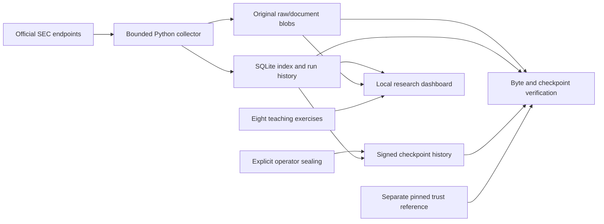
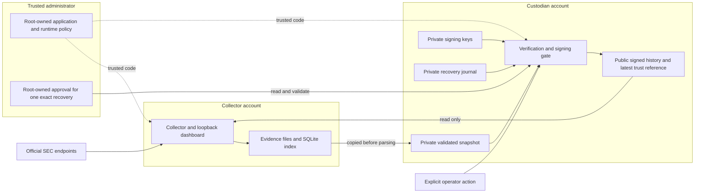
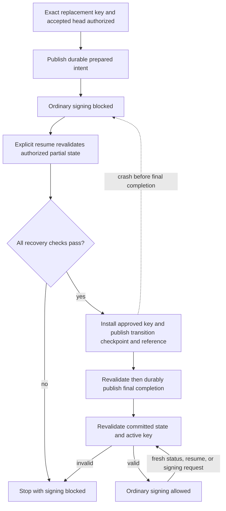
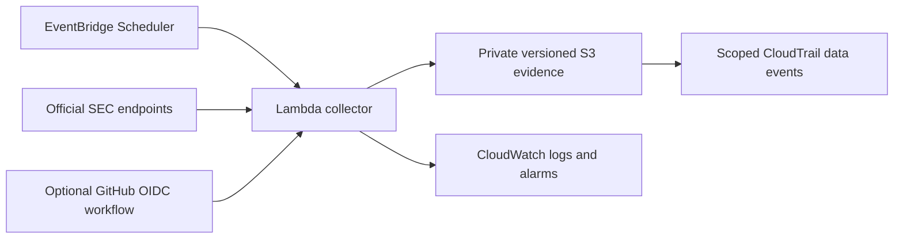

# Architecture and design decisions

Documentation review: November 1, 2026. This describes the local v0.4.0 design; it does not claim a fresh check of the installed service. Dated installation results remain in [VERIFICATION.md](VERIFICATION.md).

The local application supports standalone practice and managed macOS account separation. The prepared AWS collector is a separate, undeployed path. The repeatable reviewer demo uses synthetic evidence and throwaway keys in standalone mode; it does not establish the managed account boundary.

## Evidence flow

1. **Local Python standard library:** small installation surface, visible HTTP/SQL/file operations, and a codebase a beginner can study progressively. Python 3.11+ is required; automated checks currently run locally on 3.14. Signed checkpoints use the installed OpenSSH `ssh-keygen` executable for Ed25519 signing and verification.
2. **A source archive plus an index:** raw bytes remain available even if extraction logic changes. SQLite supports searches and links observations to runs. An index row is not the original evidence.
3. **Content-addressed storage:** identical bytes share a stored object. Each collection attempt is still recorded. A revised document creates a different hash and a new record rather than silently editing the original.
4. **Explicit source modes:** synthetic fixtures teach the system without implying live company data. Real records are labeled `live` only through the SEC collection path.
5. **Loopback-only dashboard:** avoids introducing public login/session/account recovery complexity. Host and Origin validation also address browser attacks against local services. Any public service requires a separate authentication and deployment design.
6. **No issuer HTML execution:** documents download as attachments with a binary content type. The dashboard renders metadata with textContent.
7. **Prepared AWS archive adapter:** the cloud code writes content-addressed objects and per-run manifests to S3 instead of sharing a writable SQLite database across Lambda invocations. Its proposed collector policy permits conditional writes without object reads/deletes. These permissions still need live validation; administrators remain trusted.
8. **Deployment first observed manually:** cloud scheduling defaults off until account-specific collection, permissions, notifications and cost controls have been verified. Terraform validation is not an AWS deployment test.
9. **A separate reference for accepted history:** canonical signed snapshots cover filing records, source references, and collection history. Each checkpoint links to its predecessor; the latest checkpoint and authorized public keys are pinned outside the data directory. Changing both filing bytes and their database hash cannot replace that reference. Standalone mode keeps evidence, keys, and trust under one account. Managed mode puts collection and custody under different accounts, as shown below. The custodian and administrator remain trusted.
10. **Explicit acceptance and recovery trust:** collection adds pending records, while the CLI creates checkpoints after operator review. No browser endpoint can sign or reset trust. Protected backups require all records sealed and carry public checkpoint history, never the private key or active trusted reference. Restoration accepts an exact checkpoint only against a separately retained public receipt and creates a verifier-only copy. See [LOCAL_PROTECTION.md](LOCAL_PROTECTION.md).
11. **Authorized key epochs:** recovery preserves original checkpoints and the original private-key file. A transition adds a checkpoint that binds the approved replacement identity to the previous accepted head, plus a receipt listing which public key verifies each part of history. The transition copies the last accepted snapshot; it does not seal pending records. Future ordinary checkpoints use the active authorized key.

## Managed local trust boundary

The collector can write evidence and read public references. It cannot read private keys, replace trust, modify installed code, or approve recovery. The custodian verifies a private snapshot of collector-owned inputs, rather than signing files while the collector can change them. Administrator approval lives outside the directories writable by either service account and binds the archive, accepted checkpoint, replacement public key, and action.

These controls protect against the collector's authority, not a compromised administrator, custodian, or operating system. The custodian still needs a trustworthy source-review process before accepting new evidence. A signature does not prove the financial claims inside a filing. See [LOCAL_ACCOUNTS.md](LOCAL_ACCOUNTS.md) for the installation and actual-account probes.

## Recovery and restart

Archive verification and permission to sign answer different questions. Verification checks evidence and signed history against the pinned public reference. Signing additionally checks the current private key and every committed recovery's authorization, prepared record, and completion record. A verifier-only restore does not need a private key or recovery journal.

The recovery lock and journal are derived from the trust location, so choosing a different key directory does not bypass an unfinished transition. The final completion record binds the exact prepared record, authorization digest, transition identity, and transition checkpoint. It is written last using a synchronized temporary file, atomic replacement, and directory synchronization. A temporary file is not final completion.

After completion, a recovery-status, resume, or signing request in a fresh process revalidates these bindings and the installed key. Restarting the dashboard alone is not this check. Explicit resume returns `already_completed: true` without creating another transition. Ordinary signing never completes recovery automatically, even if there are no new records to sign. Later ordinary checkpoints may advance the accepted head while preserving the completed transition and its key epoch.

Process-interruption tests exercise these states; they are not physical power-loss tests. Missing or changed material stops signing and requires investigation. The app does not create a replacement identity or reset trust to make verification pass. See [key-recovery.md](key-recovery.md).

## Prepared cloud path — AWS deferred

Cloud archives do not automatically synchronize into the local dashboard in this release. Read/download is via the restricted reader policy and AWS tooling. The desktop dashboard and private cloud collector are separate acceptance checks.

## Future work requiring a concrete need

Complete older-history pagination; earnings-exhibit selection; tested cloud-to-local manifest import; source-specific expectation records; authenticated hosted dashboard. Each should preserve provenance and historical evidence and receive appropriate tests. No scoring method or trading action is implied by this roadmap.
