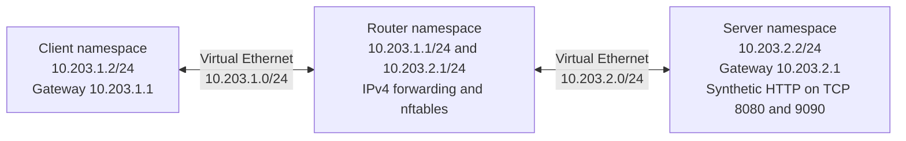

# Isolated routing and firewall lab

This lab adds a network-security case study to HELTEMES Evidence. It creates three Linux network namespaces, routes synthetic HTTP traffic through a firewall, detects an intentionally permissive rule, and verifies the repaired policy. Each run records the tested source, traffic observations, packet capture, firewall counters, and cleanup result.

The lab operates inside a disposable Linux VM and uses synthetic content. It does not require administrator changes on the personal Mac or access to the real filing archive, signing key, or accepted trust history.

The acceptance criteria below describe the required checks. A particular result is established by its completed `network_lab` job and inspection of the downloaded report. The [implementation and validation record](https://github.com/Fischerdh1/heltemes-evidence/pull/8) links the hosted runs and records the artifact review.

## Topology and policy



The namespaces share one Linux kernel and have separate network stacks, routes, interfaces, and firewall state. Two virtual Ethernet pairs connect the lab's namespaces. IPv4 forwarding is enabled inside the router namespace. The runner's existing interfaces and host firewall are outside the configured topology. The script runs with administrator authority on the disposable VM; network namespaces do not restrict that process's access to the VM's files. [Linux network namespace manual](https://man7.org/linux/man-pages/man8/ip-netns.8.html)

The intended forwarding policy permits the client to reach TCP 8080 on the synthetic server and permits the associated return traffic. TCP 9090 has a live listener, but the router's policy drops the client's attempts to reach it. A named drop counter supplies evidence that the firewall processed those attempts. nftables applies the rule set inside the router namespace. [Base chains and forwarding policy](https://wiki.nftables.org/wiki-nftables/index.php/Configuring_chains), [Named counters](https://wiki.nftables.org/wiki-nftables/index.php/Counters)

## Acceptance sequence

| Stage | Expected observation | What it establishes |
| --- | --- | --- |
| Baseline | The client receives the expected synthetic response from both server ports | Both routes and listeners work before restrictions are introduced |
| Restricted policy | TCP 8080 still returns the expected response | Required traffic remains available |
| Denied traffic | A fresh client request to TCP 9090 times out, the matching router drop counter increases, and a server-local probe confirms the listener is healthy | The observed denial agrees with the firewall decision and an available destination service |
| Injected mistake | An intentionally added permit rule makes TCP 9090 reachable, and the expected-denial check detects that policy violation | The check can identify a permissive regression |
| Repair | The restricted rule set is restored, TCP 9090 is denied again, its drop counter increases, and TCP 8080 succeeds | The repair restores the required allowed and denied behavior |
| Packet evidence | Every recorded client probe appears in the capture; successful probes have a server handshake and payload, denied probes have no captured server reply | The saved capture covers the tested connections, including the final repaired connection |
| Cleanup | Capture and service processes stop, and the namespaces and virtual links created by the run are removed | The completed run releases its temporary resources |

Each probe uses a fresh TCP connection so an earlier established connection cannot stand in for the new policy decision. A timeout alone is ambiguous because a stopped service or broken route can cause a similar symptom. The healthy-listener probe, successful allowed request, and drop-counter increase give the denial a specific explanation.

The injected permit rule is a controlled experiment. A successful run records that the expected-denial check detected it, then verifies the repaired policy. An unexpected probe result, source mismatch, failed capture, or incomplete cleanup stops successful artifact publication.

### Why packet validation is required

In the [first hosted run](https://github.com/Fischerdh1/heltemes-evidence/actions/runs/41976408046), the traffic checks passed, but independent inspection found that the saved 51-packet capture omitted the final repaired TCP 8080 connection. The capture had stopped before buffered delivery finished. That green job was not accepted as complete packet evidence. The script now requests immediate delivery, waits for evidence for every client probe, and validates the closed capture again. Regression checks cover a missing final flow, malformed or unrelated packets, and a capture that never becomes complete. The original downloaded artifact is retained locally as a failing example. This illustrates why a passing traffic check and a complete saved record are separate requirements.

## Inspect the hosted result

The `network_lab` job runs on a disposable GitHub-hosted Ubuntu 24.04 VM after the Python checks. It installs the required Linux tools, performs the lab with administrator authority inside that temporary VM, and uploads explicitly selected report files with 30-day retention. The repository token has read-only permissions. Standard GitHub-hosted Ubuntu VM runners provide passwordless `sudo` for this workflow. [GitHub-hosted runner privileges](https://docs.github.com/en/actions/reference/runners/github-hosted-runners#administrative-privileges)

Open the relevant **Actions → Verify project → network_lab** result. Confirm the job succeeded and read its summary before downloading the artifact. Check the source commit, actual run time, probe outcomes, counter changes, and cleanup status. Pull-request runs identify the tested merge result separately from the proposed branch head.

The report is intended to contain these fixed evidence files:

| File | Review purpose |
| --- | --- |
| `REPORT.json` | Source identity, run context, topology, observations, counters, and cleanup outcome |
| `MANIFEST.json` | SHA-256 fingerprints of the retained evidence files |
| `packet-capture.pcap` | Packets captured on the isolated router's client-facing `lan0` interface |
| `packet-capture.txt` | A decoded view of that same capture |
| `policy.nft` | The intended restricted forwarding rules |
| `misconfigured-policy.nft` | The deliberate permit-rule mistake used by the detector check |
| `SUMMARY.md` | A readable explanation of the observed run |

Capture is scoped to the router's client-facing `lan0` interface and filtered to the exact client/server IPv4 addresses and TCP ports 8080/9090. Immediate delivery is requested, and the script waits up to five seconds for packet evidence for every recorded client probe before stopping capture. It then waits for the process to exit and validates the final PCAP again before hashing it. Malformed records, unrelated flows, or missing probe evidence fail the run. The seven evidence files are published under the requested output directory's `publish` folder only after the checks and cleanup succeed. Compare the manifest with the downloaded files, then inspect the per-flow packet observations alongside the firewall counters. The manifest provides a consistency reference whose trust depends on its source and custody. [tcpdump immediate delivery](https://raw.githubusercontent.com/the-tcpdump-group/tcpdump/master/tcpdump.1.in)

Artifacts expire after the configured retention period or may be removed earlier by repository administration. Select a separately checked release when preserving a longer-lived portfolio milestone. [Workflow artifact retention](https://docs.github.com/en/actions/tutorials/store-and-share-data)

## Reproduce in a disposable Linux VM

The runner uses Python 3.11 or later, Git, `iproute2`, `nftables`, and `tcpdump`. It requires Linux network namespaces and administrator authority to create the topology. Use a clean, committed checkout so the recorded source identity can be checked.

From the repository root in a disposable Ubuntu 24.04 VM:

```sh
sudo apt-get update
sudo apt-get install --yes iproute2 nftables tcpdump
mkdir -p work
sudo "$(command -v python3)" -I -S -B scripts/network_lab.py --output "$PWD/work/network-lab"
```

Choose a new output directory for each run. The script creates uniquely named namespaces and virtual links and refuses to adopt pre-existing output or lab resources. Its cleanup targets only resources created by that invocation. The automated GitHub run supplies the selected public workflow identifiers used in the report. A local VM run identifies its local execution context.

## Two-minute interview walkthrough

Start with the topology. “This case study uses a client, router, and server in separate Linux network namespaces. Two virtual Ethernet networks force the client's traffic through the router.”

Explain the baseline and policy. “Both services respond before filtering. The intended policy then allows the research-service port while dropping the second port. I check a working listener, a successful allowed request, and an increased drop counter to explain why the denied request failed.”

Show the regression. “The lab deliberately inserts a rule that opens the restricted port. The detector identifies the resulting policy violation. After restoring the rules, it repeats the allowed and denied probes.”

Point to the evidence. “The report ties those observations to the tested source and includes a packet capture, the rules, counters, and cleanup result. I can show the specific run and explain the expected and observed outcomes.”

Keep the scope precise. The implemented case study concerns IPv4 routing, forwarding policy, synthetic HTTP probes, and investigation using counters and packet capture. TLS validation, DNS behavior, physical network devices, and operating a cloud environment are separate future milestones. The installed Evidence application's custody controls and real filing archive have their own verification records. AWS deployment remains deferred.

## Implementation references

- [Linux network namespace operations and cleanup](https://man7.org/linux/man-pages/man8/ip-netns.8.html)
- [nftables base chains and policy](https://wiki.nftables.org/wiki-nftables/index.php/Configuring_chains)
- [Atomic nftables rule replacement](https://wiki.nftables.org/wiki-nftables/index.php/Atomic_rule_replacement)
- [nftables counters](https://wiki.nftables.org/wiki-nftables/index.php/Counters)
- [GitHub-hosted runner privileges](https://docs.github.com/en/actions/reference/runners/github-hosted-runners#administrative-privileges)
