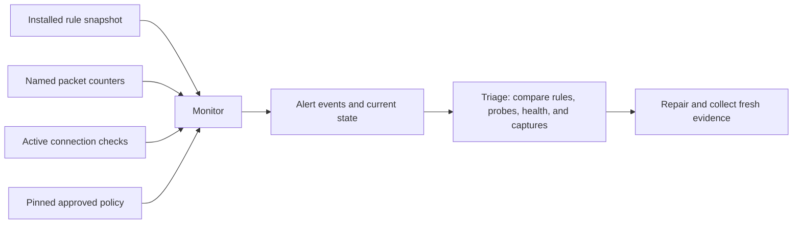

# Monitoring and alerts for the network lab

This exercise observes a fresh copy of the [three-zone segmentation topology](NETWORK_SEGMENTATION.md). It reads installed firewall rules and counters, makes controlled connection checks, and records alerts with the evidence that opened, updated, or resolved them. The monitor runs for a bounded exercise on a disposable Linux runner. It does not install a background service on the Mac or send external notifications.

The approved network policy stays the same: users may reach application TCP 8080; management may reach application TCP 8080 and 9090; the other tested inter-network paths are denied. Port 9090 is a synthetic HTTP management endpoint, not an SSH service or an authenticated administrator identity.

## How observations become alerts



The harness installs the committed approved policy in its newly owned router namespace, then saves and pins the resulting rule snapshot. Later observations cannot replace that reference. This controlled setup establishes the reference for the exercise; observing an arbitrary existing firewall would not establish that its initial rules are trustworthy.

Rule comparison removes runtime metadata such as object handles and named-counter packet/byte totals, but retains rule order and semantic fields. That prevents routine counter growth from being mistaken for a rule change. Object identities and counter values are tracked separately to identify broken continuity. nftables provides JSON ruleset output and object handles for these observations. [nft command documentation](https://netfilter.org/projects/nftables/manpage.html)

| Signal | What causes it | What it establishes |
| --- | --- | --- |
| Blocked traffic | A counter increases across a valid interval and its current rule binding confirms the scoped drop | Packets matched that drop rule; this can be expected policy enforcement |
| Rule drift | The observed rule configuration differs from the pinned reference | Configuration changed; the connection checks show its tested effect |
| Forbidden path open | A connection that should be denied returns the expected service response | The tested policy boundary failed |
| Allowed path unavailable | A permitted connection fails | Required access is unavailable; a healthy destination plus matching drop evidence supports a firewall diagnosis |
| Telemetry gap | An observation is missing, invalid, stale, or out of sequence | The monitor lacks reliable coverage and must not claim everything is healthy |
| Counter discontinuity | Object identity changes, counters disappear, or values decrease | The previous and current totals cannot safely be subtracted |

Counters measure packets and bytes since reset, not unique connections. A single TCP attempt may produce multiple packets through retransmission. A counter's name alone does not establish the rule's verdict: a rule named for dropping traffic could be changed to accept it. The monitor requires the scoped drop binding at both ends of the observed interval before using that delta as drop evidence. Unsupported dynamic counter references make attribution unconfirmed. Sampling still cannot exclude changes introduced and removed between observations. A blocked-traffic observation does not prove malicious intent, compromise, or a particular number of attackers. [nftables counters](https://wiki.nftables.org/wiki-nftables/index.php/Counters)

## Active checks and their limits

The monitor uses three canaries, meaning small controlled connection tests:

| Canary | Expected result |
| --- | --- |
| User → application TCP 8080 | Expected application response |
| User → application TCP 9090 | TCP connection denied |
| Management → application TCP 9090 | Expected management-endpoint response |

Every timed-out routed probe receives a separate destination-local health check. Three captures observe the source-facing and destination-facing router interfaces. Successful flows need handshake and response evidence on both sides. Denied flows need a source-side attempt, no destination-side packets, a healthy listener, and the corresponding counter evidence.

These three canaries provide targeted monitoring coverage. They do not replace the separate twelve-row segmentation test, scan every port, or prove a general absence of unauthorized traffic. A correct configuration fingerprint and successful canaries support only the observed scope and time.

## Walk through the demonstration

1. **Observe approved operation.** Confirm the approved rule reference and check normal application access, denied user management access, and permitted management access.
2. **Repeat blocked traffic.** Generate further denied user requests. The counter delta records new dropped packets; repeated observations update the same alert occurrence rather than opening duplicate incidents.
3. **Open the wrong path.** Deliberately allow user → application TCP 9090. Read the rule change before sending the forbidden probe. Rule drift and demonstrated forbidden access are distinct signals.
4. **Keep the mistake present.** Repeat the forbidden request to verify deduplication. Explicitly simulate a missing collector observation. Existing alerts must stay unresolved while monitoring is unavailable; missing evidence is not evidence of recovery.
5. **Repair the permit mistake.** Restore the approved rules. Replacing the rules can reset counters, so establish a new valid comparison interval before accepting the denied canary as recovery evidence.
6. **Block required access.** Replace the user → application TCP 8080 permit with a drop. Detect rule drift and the failed allowed canary while confirming that the destination service itself remains healthy.
7. **Repair and revalidate.** Restore approved rules and obtain fresh results for the complete three-canary set. Only evidence relevant to an alert can resolve it. Stop captures, validate the saved files, and remove owned lab resources before publication.

The collection outage is an explicitly labeled injected fault in the harness. The traffic, firewall rules, counter reads, and captures use actual Linux networking. The run is a test of detection and recovery behavior, not an operational uptime or incident-response record.

## Alert lifecycle and coverage

An alert has a stable condition key and a separate occurrence identity. Repeated observations of an unresolved condition update it; a later recurrence after resolution is a new occurrence. Events reference the observation that caused each state change.

Restoring the approved configuration can resolve rule drift while a forbidden-access alert still awaits a fresh denied probe. A quiet counter interval can end a blocked-packet observation; it does not prove an attacker stopped or that an incident was fully investigated.

Missing telemetry, a counter reset, or an unrelated successful canary cannot silently clear unresolved network findings. Counter deltas across a coverage gap are unknown, rather than zero or negative. Complete current canary coverage is required before a healthy status is justified.

The monitor samples at explicit points in this bounded exercise. It may miss a transient change introduced and removed between samples. This implementation does not subscribe to every kernel change event, supply a permanent monitoring daemon, guarantee detection latency, or deliver email/Slack/pager notifications. Its lifecycle state is scoped to one run. The separate [service-restart exercise](NETWORK_MONITOR_RESTART.md) adds a transactional journal and verifies recovery across actual supervised process restarts.

## Inspect the evidence

Open **Actions → Verify project → network_lab**. Confirm all five network exercises and the final job passed, then download `network-monitoring-<commit>-<run ID>-<attempt>`. An earlier successful network artifact does not establish the monitoring result.

| File | Review purpose |
| --- | --- |
| `REPORT.json` | Tested source/run, scenario assertions, capture evidence, final status, and cleanup |
| `APPROVED_POLICY.json` | Pinned rule reference from controlled installation |
| `SNAPSHOTS.json` | Actual rule/counter reads and probe observations, including the explicitly missing observation |
| `EVALUATIONS.json` | Per-observation comparisons, counter deltas, coverage, and active alert keys |
| `ALERTS.json` | Alert occurrences and their final states |
| `EVENTS.jsonl` | Ordered opened, updated, and resolved events with evidence references |
| `policy.nft`, `overblocked-policy.nft` | Approved policy and deliberate legitimate-access denial |
| Three `.pcap` files and three `*-packets.txt` files | Scoped packet evidence on user, application, and management interfaces |
| `SUMMARY.md` | Readable scenario result |
| `MANIFEST.json` | SHA-256 fingerprints of the other fifteen files |

The artifact has exactly sixteen files and 30-day retention. Counts summed across interfaces are packet observations, not deduplicated unique packets. Publication requires complete closed captures with zero kernel-reported packet drops, unchanged committed source, and successful cleanup. File hashes bind the bundle's contents to its reference; these reports are not the real Evidence application's signed checkpoints.

## Reproduce on a disposable Linux VM

Use a clean committed checkout with Python 3.11+, Git, `sysctl`, `iproute2`, `nftables`, and `tcpdump`. From the repository root:

```sh
mkdir -p work
sudo "$(command -v python3)" -I -S -B scripts/network_monitoring_lab.py --output "$PWD/work/network-monitoring"
```

Use a new output directory. The macOS guard refuses before creating output or network resources. The exercise owns four namespaces, six virtual-link endpoints, three synthetic service processes, and three capture processes. It changes forwarding and firewall rules only inside its new router namespace.

## Explain it in an interview

“I monitor both configuration and behavior. A rule comparison can detect a changed permit before I exercise it, while active probes show whether forbidden access is actually possible or required access has broken. Packet captures, destination health checks, and counter changes help explain the result.”

“I keep missing telemetry distinct from a healthy result. After a rule reload, the counters may restart, so I establish a fresh interval and retest before clearing the access alert. Repeated observations update the same unresolved finding.”

This is synthetic routed IPv4 monitoring in a disposable lab. It is not evidence of production SOC operation, user authentication, physical VLAN configuration, comprehensive intrusion detection, or administrator-resistant logging. AWS, the installed Evidence app, the real signing key, and trusted history remain outside the exercise.
