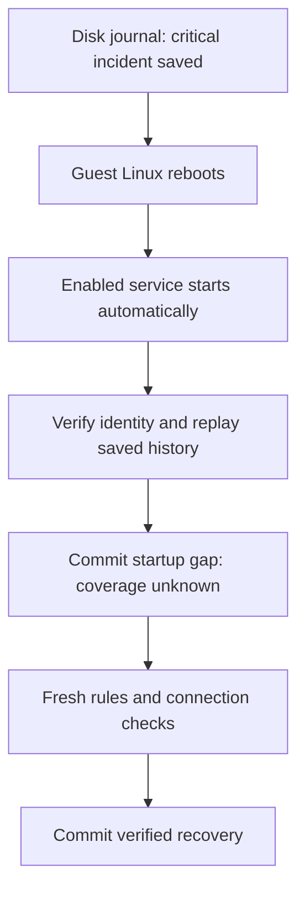

# Monitoring across a full Linux VM reboot

This lab extends the [process-restart exercise](NETWORK_MONITOR_RESTART.md) with a disk-backed journal and a service that starts during Linux boot. A disposable Ubuntu guest runs inside QEMU on a fresh Linux test runner. The controller requests an orderly reboot of the guest operating system, waits for the new boot, and inspects the monitor before submitting new observations.

The installed Evidence app, real signing key, filings, trusted history, and AWS deployment are outside this lab. The guest receives only an explicit list of lab source files and newly generated temporary access credentials.

## Why a process restart was not enough

The earlier exercise keeps its disposable database under `/run`. That directory is temporary runtime storage. It survives a worker-process restart but is cleared when Linux boots again. Its transient service also exists only for that boot.

The reboot exercise makes two changes:

1. Save the journal and its identity under `/var/lib/heltemes-reboot-lab/state` on the guest's disk.
2. Install and enable a systemd unit so Linux starts the existing monitor during boot.

Initialization remains a separate explicit action. The boot service only opens existing state; it cannot create an empty replacement for a missing or invalid journal. The observation engine and transaction/replay rules remain the same as the process-restart lab.

## Walk through the reboot

1. **Establish the baseline.** Fresh rules and connection checks establish healthy coverage in the synthetic network.
2. **Create a detectable failure.** An incorrect permit makes a restricted management endpoint reachable. The monitor saves a critical incident.
3. **Save the preboot reference.** The controller retains the journal identity, exact committed history, incident identity, boot ID, and service configuration outside the guest.
4. **Reboot Linux.** The controller asks the guest operating system to reboot. It keeps the same virtual disk and QEMU process; it does not create a replacement guest or start the monitor manually afterward.
5. **Inspect automatic startup.** The new boot must have a different kernel boot ID. The enabled monitor must already be running with the same journal identity and committed history. Its newly appended startup gap reports unknown coverage while preserving the unresolved incident.
6. **Revalidate the network.** Fresh synthetic networking and approved rules are established after boot. Fresh measurements are committed before the incident resolves and the current result becomes healthy.



Network namespaces and packet counters are temporary kernel state. Recreating them is separate from recovering the monitor's saved history. Counter comparisons must not bridge the reboot gap, and a previous healthy result cannot establish current health.

## Evidence and acceptance

The host controller and guest each retain evidence. Acceptance checks require a changed guest boot ID, automatic service startup, persistent disk identity, an unchanged journal prefix, and the same incident identity. Packet captures show the actual synthetic connection attempts before and after reboot. Checksums bind the public files to one another, and source hashes identify the code used for the run.

The controller keeps its preboot reference outside the guest while the guest reboots. That reference detects an unexpected reset during this test. It is not an independently administered long-term trust anchor.

The fixed public artifact excludes SSH private keys, cloud-init seed material, virtual disk images, unrestricted console logs, and live database files. Publication follows successful validation and cleanup. Inspect the `monitor_reboot` job and its `monitor-reboot-<commit>-<run ID>-<attempt>` artifact in **Actions → Verify project**. Artifacts are retained for 30 days.

| File | What to inspect |
| --- | --- |
| `REPORT.json`, `VM.json` | Source/run provenance, guest reboot evidence, VM identity, and cleanup |
| `BEFORE.json`, `AFTER.json` | Saved history, service and storage observations, incident continuity, and fresh recovery |
| `APPROVED_POLICY.json`, `monitor.service` | The unchanged intended policy and installed boot service |
| Six `.pcap` files and six packet-text files | Three router-interface captures for each boot's synthetic network exercise |
| `SUMMARY.md`, `MANIFEST.json` | Readable result and SHA-256 fingerprints for the other nineteen files |

The required reviewer job explicitly checks that the reboot job and every other prerequisite succeeded. Its guard runs even when a prerequisite fails or is skipped. A successful process-restart test alone does not satisfy the reboot demonstration.

## Reproduce on a disposable Linux host

Use a clean committed checkout on an x86-64 Linux host with Python 3.11+, Git, curl, OpenSSH client tools, QEMU system emulation, `qemu-img`, and `cloud-localds`. On Ubuntu the additional packages are `qemu-system-x86 qemu-utils cloud-image-utils openssh-client`.

```sh
mkdir -p work
python3 -I -S -B scripts/network_monitor_reboot_vm.py --output work/monitor-reboot
```

Choose a new output directory. The host controller runs without administrator privileges. It uses QEMU user networking with SSH forwarded only to loopback and a fresh pinned guest host key. Hardware acceleration is used when accessible; software emulation is the fallback. The guest has its own operating system and disk, and administrator actions are confined to that disposable guest.

The Ubuntu image is selected by a dated official URL and a pinned SHA-256 digest. Changing the image is an explicit source change. Guest package installation requires Internet access. No host directory is shared into the guest.

## What to say in an interview

Use the following explanation only after the corresponding run and its saved evidence pass verification. A built harness or green unit test alone does not establish an actual VM reboot.

“I separated persistent monitoring history from temporary kernel state. The monitor's journal lives on disk, and an enabled Linux service opens and verifies that existing history during boot.”

“I tested an actual guest-OS reboot. The new boot ID changed, the saved journal identity and history stayed the same, and the monitor started automatically. It reported unknown coverage until fresh checks justified recovery.”

## Limits

This demonstrates an orderly full Linux guest reboot. Sudden power removal, storage-controller failures, disk loss, long-running retention, continuous collection, external notification delivery, and administrator-resistant custody remain separate work. The journal remains bounded to 256 rows. The lab's root-owned service is not evidence of dedicated-account isolation.

The temporary VM and its private credentials are removed after evidence export. The lab does not install a permanent service on the Mac or change its firewall. AWS remains deferred.

## References

- [Ubuntu cloud image formats](https://ubuntu.com/docs/public-images/public-images-reference/artifacts/)
- [Cloud-init NoCloud datasource](https://docs.cloud-init.io/en/latest/reference/datasources/nocloud.html)
- [QEMU invocation and user-network forwarding](https://www.qemu.org/docs/master/system/invocation.html)
- [systemd execution and filesystem dependencies](https://manpages.ubuntu.com/manpages/noble/man5/systemd.exec.5.html)
