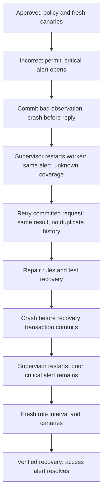

# Restart-safe monitoring in a disposable Linux VM

This exercise extends the [sampled network monitor](NETWORK_MONITORING.md) with a saved journal and a real Linux service supervisor. It deliberately terminates the worker at two transaction boundaries and checks what a new process can safely conclude. The lab uses fresh synthetic services and network namespaces on a disposable Ubuntu runner.

AWS, the installed Evidence app, its signing key, filings, and accepted history are outside the exercise. The monitor's state identity is a separate disposable lab identifier.

The separate [full VM reboot exercise](NETWORK_MONITOR_REBOOT.md) extends this work with persistent disk storage and a boot-enabled service. The process-restart exercise below retains its original temporary-storage scope.

## What is saved

Each accepted observation and its resulting evaluation/events are committed together in a SQLite transaction. The journal uses rollback-journal mode and full synchronization. On reopening, the program checks the state identity, approved policy, schema and engine version, then replays the observations and compares the saved outcomes. It does not restore an arbitrary serialized Python object.

SQLite transactions provide the all-or-nothing boundary used here. The actual durability of storage also depends on filesystem and hardware behavior. Our demonstration tests abrupt process termination; it does not test physical power loss or reboot the VM. [SQLite atomic commits](https://www.sqlite.org/atomiccommit.html), [SQLite synchronization settings](https://sqlite.org/pragma.html#pragma_synchronous)

Initialization is a separate explicit operation that requires a new private state directory. Normal startup cannot silently replace a missing or invalid journal with an empty one. A lifetime lock excludes a second writer. The socket and state files are private to the lab's account. The demonstration caps the journal at 256 rows and stops accepting new observations at that bound; long-running retention and rotation are future work.

The saved reference pins the approved rule configuration and monitor engine. A source change requires an explicit future migration decision; accepting a different engine or policy is not an automatic side effect of restart.

## Service lifecycle

The lab creates one uniquely named transient systemd service with restart-on-failure. It observes the actual process identifier, instance identifier, restart counter, and exit status. It checks socket readiness separately from the supervisor's running state: a running process alone does not establish valid monitoring.

Every worker startup performs this sequence before accepting requests:

1. Open and validate the existing state.
2. Replay the committed observations and reconstruct the same incident identities.
3. Commit a restart/collection-gap observation.
4. Open the private Unix socket.

That gap preserves unresolved network findings and sets current coverage to unknown. A previous healthy result remains historical; a restart must obtain fresh rule and connection observations before reporting healthy again. Counter comparisons do not cross the restart gap.

systemd supervises the process and restarts it after a nonzero exit. It does not decide whether the network is healthy. The monitor's own evaluation supplies that result. [Ubuntu systemd service documentation](https://manpages.ubuntu.com/manpages/noble/man5/systemd.service.5.html), [Transient service creation](https://manpages.ubuntu.com/manpages/noble/man1/systemd-run.1.html)

## Walk through both crashes



### Crash after commit, before acknowledgement

The worker commits a new observation while the forbidden management endpoint remains reachable, then exits with the deliberately injected code 72 before answering its caller.

The supervisor starts a new process. The committed record and original critical incident survive. The new process records unknown coverage. Retrying the exact request identifier and content returns the original committed result without adding another observation or incident. The reply labels that result as historical and reports current state separately.

Changing the content while reusing that request identifier is rejected. Idempotency means a repeated submission cannot be mistaken for another independent observation; it does not make an old successful result evidence of current health.

### Crash before committing recovery

The harness restores the approved rules and makes fresh connection checks. The candidate evaluation would resolve the forbidden-access finding, but the worker exits with injected code 71 before its transaction commits.

After restart, that candidate is absent from committed history. The earlier critical incident is still open, and current coverage is unknown. The candidate's actual network traffic remains in the controller's observation record and captures, so the distinction between observed traffic and committed monitoring state is visible.

A fresh rule observation establishes a new measurement interval. The harness then repeats all three monitored canaries. Only this completed, committed verification resolves the access finding.

The test-only crash switches require an explicit service launch flag. They are exercised only against disposable lab state.

## What the result proves

The acceptance checks require:

- Two observed nonzero worker exits at the selected boundaries, followed by two actual supervisor restarts with new process/instance identifiers.
- The same critical incident identity before and after restart.
- Unknown current coverage immediately after each restart.
- A committed retry with unchanged row/event counts, plus rejection of conflicting content under the same request identifier.
- No committed row or resolution events from the interrupted recovery transaction.
- Fresh rule/counter coverage and all three canaries before final healthy status.
- Complete evidence for every routed probe, including the uncommitted recovery candidate.
- Successful service, socket/state, namespace, link, and child-process cleanup before publication.

Expected denied traffic may retain informational records while the freshly tested policy is healthy. The final report distinguishes those observations from unresolved high/critical findings.

## Inspect the sixteen-file artifact

Open **Actions → Verify project → network_lab** and confirm all five network exercises and the final job pass. Download `monitor-restart-<commit>-<run ID>-<attempt>`. Artifacts are retained for 30 days.

| File | Review purpose |
| --- | --- |
| `REPORT.json` | Source/run identity, scenario assertions, final status, captures and cleanup |
| `APPROVED_POLICY.json` | The unchanged approved rule reference |
| `OBSERVATIONS.json` | Controller observations, including traffic whose transaction was interrupted |
| `JOURNAL.json` | Export of committed monitor history and replayed evaluations |
| `ALERTS.json`, `EVENTS.jsonl` | Incident identities and their lifecycle evidence |
| `SERVICE.json` | Filtered supervisor/process observations and crash/restart/retry results |
| `SUMMARY.md` | Human-readable walkthrough and observed result |
| `policy.nft` | Intended network policy |
| Three `.pcap` files and three `*-packets.txt` files | Evidence at user, application and management router interfaces |
| `MANIFEST.json` | SHA-256 fingerprints for the other fifteen public files |

Raw SQLite files, live sockets, unit command lines, and unrestricted supervisor logs are excluded from the public artifact. Reports use synthetic observations and selected public metadata. A file manifest is a consistency reference, not a signed or externally anchored incident log.

## Reproduce the full Linux demonstration

Use a clean committed checkout in a disposable Ubuntu 24.04 VM with a running systemd system manager, Python 3.11+, Git, `sysctl`, `iproute2`, `nftables`, and `tcpdump`. From the repository root:

```sh
mkdir -p work
sudo "$(command -v python3)" -I -S -B scripts/network_monitor_restart_lab.py --output "$PWD/work/monitor-restart"
```

Choose a new output directory. The Linux/system-manager checks run before creating resources. macOS refuses the namespace exercise. The harness owns one unique transient unit and a short private runtime path, so cleanup targets those exact resources. It never installs a persistent unit on the Mac or changes its firewall.

The lab deliberately keeps its disposable database under `/run`, which is temporary runtime storage. This path survives a worker-process restart, but is not intended to preserve state across a VM reboot.

The VM harness runs with administrator privileges to create its networks and transient unit. This is not a demonstration of a dedicated unprivileged service account. The worker accepts observations through a private local socket; the harness performs the live network collection.

## Boundaries and interview explanation

“I distinguish a saved observation from an acknowledged request. If a crash happens after commit, retrying returns the same committed result. If it happens before commit, the candidate result is absent and the prior alert remains.”

“Restarting the process does not prove the network recovered. The new worker replays the committed history, marks monitoring coverage unknown, and requires fresh checks before clearing the incident.”

Committed-state survival is tested across abrupt process exits and actual systemd restarts. Uncommitted observations can be lost. Continuous collection, remote notifications, real incidents, VM reboots, hardware power failures, long-running service reliability, and administrator-resistant log custody are separate milestones.

The database and its identity file reside on the same disposable VM. An administrator able to replace both could roll them back or fabricate new state. This workflow supplies crash recovery and consistency checks; it does not replace an independently protected off-device trust record.
