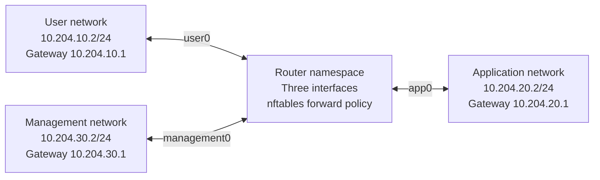

# Segmentation between user, application, and management networks

This exercise adds three separate IPv4 networks connected through one policy-enforcing router. It tests which new connections may cross those boundaries, proves denied destinations are healthy, introduces a permissive rule by mistake, and repeats the policy matrix after repair. It runs on a disposable Linux VM with synthetic HTTP services.

The original [routing exercise](NETWORK_LAB.md), [DNS/TLS exercise](NETWORK_SERVICES_LAB.md), and this segmentation exercise have separate reports. The [monitoring expansion](NETWORK_MONITORING.md) adds rule snapshots, packet-counter deltas, active canaries, and alert recovery. All four network exercises must pass the required `network_lab` job. A particular run is accepted only after its checks, packet evidence, cleanup, and downloaded artifact inspection succeed. AWS, the installed Evidence application, its real signing key, and accepted history remain outside this exercise.

## Topology



Four fresh network namespaces and three virtual Ethernet pairs create the topology. The router forwards IPv4 only within its namespace. Each endpoint has a live synthetic listener on TCP 8080 and 9090, including destinations that the policy will deny. That lets the test distinguish a policy denial from a missing service. No router interface connects to the host's external network. Network namespaces isolate network stacks; the root process running the exercise still has authority over the disposable VM's files. [Linux network namespace boundaries](https://man7.org/linux/man-pages/man7/network_namespaces.7.html)

## Rules for new connections

Port 8080 models application access. Port 9090 models a management endpoint using synthetic HTTP. The management label describes a source network; it is not proof that a person or process has authenticated as an administrator.

| Initiating network → destination | TCP 8080 | TCP 9090 |
| --- | --- | --- |
| User → application | Allow | Block |
| User → management | Block | Block |
| Application → user | Block | Block |
| Application → management | Block | Block |
| Management → application | Allow | Allow |
| Management → user | Block | Block |

The matrix contains twelve cases: three permitted and nine denied. Management can inspect the application's normal service and reach its management endpoint, but receives no general access to the user network. The application can respond to an approved request; it cannot use that permission to initiate an unrelated connection back to the user or management endpoint.

Rules match ingress and egress interfaces, exact endpoint addresses, service ports, and connection-tracking state. Return rules are tied to the approved initiating paths and reply direction. There is no broad established-connection exception that would authorize every network pair. Each matrix decision has a named counter. Traffic outside the configured permits falls through to the default-deny policy. The twelve tests establish the matrix above; they do not exhaustively test every address, protocol, or port. [Interface matches](https://wiki.nftables.org/wiki-nftables/index.php/Matching_packet_metainformation), [Connection tracking](https://wiki.nftables.org/wiki-nftables/index.php/Matching_connection_tracking_stateful_metainformation)

## Walk through the run

1. **Prove the baseline.** Temporarily permit all twelve matrix paths. Every service must return its expected zone and port. This establishes working routes and listeners before restrictions are applied.
2. **Apply segmentation.** Run all twelve cases under the intended policy. An allowed request must return the expected synthetic response and increment its permit counter. A denied request must time out while connecting, increment its specific drop counter, and pass a separate destination-local health check.
3. **Detect an incorrect exception.** Deliberately permit user → application TCP 9090. The client reaches the management endpoint, and the expected policy identifies this as a violation.
4. **Repair and retest.** Restore the intended policy and repeat all twelve cases, including management access and the reverse-direction denials. Every probe uses a new explicitly recorded source port.
5. **Validate the evidence and clean up.** Check the three closed packet captures, stop the known service/capture processes, remove the owned namespaces and interfaces, and publish only after success.

This sequence contains 37 routed probes: twelve baseline, twelve restricted, one injected exception, and twelve repaired. The restricted and repaired phases each require three successes and nine denied attempts. Health checks stay inside the destination namespace and are recorded separately from routed probes. Rules are replaced atomically inside the router namespace. [Atomic nftables replacement](https://wiki.nftables.org/wiki-nftables/index.php/Atomic_rule_replacement)

## What the captures establish

Three capture processes observe only the router's named lab interfaces. Each filter is limited to its attached endpoint, the other two endpoint addresses, and TCP 8080/9090. The captures use immediate delivery, a bounded wait for expected evidence, and validation again after every capture process has exited. Each capture must report zero kernel-dropped packets, and its reported packet count must match the saved file.

For an allowed connection, both the source-facing and destination-facing captures must show the SYN, successful return handshake, and server payload. For a denied connection, the source-facing capture must show the attempted SYN with no server reply, and the destination-facing capture must contain no packets for that connection. The destination health check and exact drop-counter increase support the firewall conclusion. A flow on the unrelated third interface, an unrecorded flow, malformed packet data, or missing final probe fails validation.

A forwarded packet can appear in two captures. Summed capture counts are observations across interfaces, not a count of unique packets. The report keeps source and destination observations separate for every probe.

## Inspect or reproduce the result

Open **Actions → Verify project → network_lab** and inspect the segmentation step, summary, and final job status. Download `network-segmentation-<commit>-<run ID>-<attempt>`. Earlier network artifacts do not establish this exercise's result.

| File | Review purpose |
| --- | --- |
| `REPORT.json` | Tested source/run, topology, phase results, counters, capture verification, and cleanup |
| `MATRIX.json` | Intended access matrix and the recorded policy observations |
| `policy.nft` | Intended forwarding policy |
| `misconfigured-policy.nft` | Deliberate user-to-management-endpoint exception |
| `user.pcap`, `app.pcap`, `management.pcap` | Scoped captures for the three router interfaces |
| `user-packets.txt`, `app-packets.txt`, `management-packets.txt` | Decoded views of those captures |
| `SUMMARY.md` | Readable outcome summary |
| `MANIFEST.json` | SHA-256 fingerprints for the other eleven public files |

The artifact has exactly twelve files and 30-day retention. A source-bound manifest provides a consistency reference; its trust depends on source and reference custody. It is separate from the Evidence application's signed checkpoints. Preserve selected portfolio milestones in separately checked long-term packages.

From a clean committed checkout in a disposable Ubuntu 24.04 VM with Python 3.11+, Git, `sysctl`, and the following tools:

```sh
sudo apt-get update
sudo apt-get install --yes iproute2 nftables tcpdump
mkdir -p work
sudo "$(command -v python3)" -I -S -B scripts/network_segmentation_lab.py --output "$PWD/work/network-segmentation"
```

Use a new output directory. The macOS guard stops before creating network resources. Cleanup targets only the four namespaces, six virtual endpoints, and six long-running child processes created by a successful invocation. Failures during setup have fewer owned resources to remove. The program does not change the Mac's network settings or inspect the real filing archive.

## Explain the result accurately

“The policy controls who can initiate a connection. Users can access the application service; management can access that service and the management endpoint. Other tested inter-network connections are denied. Responses are scoped to approved connections, so return traffic does not grant unrestricted reverse access.”

“I can show an attempted connection at the source interface, its absence at the destination interface, a healthy destination listener, and an increased drop counter. The lab also demonstrates a deliberately over-permissive exception and a complete matrix retest after repair.”

This is routed IPv4 segmentation between synthetic Linux namespaces. It does not demonstrate physical VLANs or switch trunks, same-network isolation between multiple hosts, user authentication, SSH administration, IPv6 policy, source-spoofing resistance under attack, Internet egress filtering, or production network operation. DNS and TLS retain their separate exercises. AWS remains deferred.
