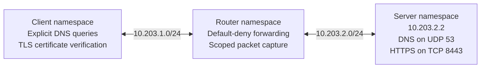

# Diagnose DNS, connection, and TLS failures

This expansion asks three separate questions: did DNS return the expected address, could the client establish a connection, and did TLS accept the server's certificate? It runs after the [routing and firewall exercise](NETWORK_LAB.md) on a disposable Ubuntu 24.04 GitHub runner, using new network namespaces and synthetic services. Both exercises must pass the required `network_lab` job.

A particular result is established by its completed workflow and downloaded evidence. The report records the tested commit, actual execution time, individual probes, capture observations, firewall counters, and cleanup outcome. This source change does not deploy AWS or change the installed HELTEMES Evidence application, real signing key, or accepted history.

## What is added



The DNS service answers a narrow lab-specific A-record query: `evidence.test` maps to `10.203.2.2`. The configured `unknown.test` name receives NXDOMAIN. These are explicit unicast queries to the lab server on UDP 53. The exercise does not change the host resolver or contact a public DNS provider. Names under `.test` are reserved for testing. [Reserved test names](https://www.rfc-editor.org/rfc/rfc2606.html)

Each run creates a temporary certificate authority (CA), a server certificate for `evidence.test`, and an unrelated CA used for a negative test. The TLS client trusts only the CA file selected for that probe and requires hostname and certificate-chain verification. A successful probe records the negotiated TLS version and the peer certificate's public fingerprint. The generated certificate identity is separate from the Evidence application's signing identity. [Python TLS client verification](https://docs.python.org/3.14/library/ssl.html)

The router permits DNS queries and HTTPS connections through its forward chain. A deliberately changed policy blocks TCP 8443 while allowing DNS. The same router interface captures only client/server DNS and TLS traffic. The namespaces isolate network stacks on one VM; the root process running the lab still has authority over that disposable VM's files.

## Walk through the checks

| Step | Observation required | Explanation |
| --- | --- | --- |
| Resolve and connect | DNS returns the expected address; HTTPS returns the expected synthetic body with an accepted certificate | The name, route, service, and selected TLS trust configuration work together |
| Unknown name | The DNS reply is NXDOMAIN; the client does not attempt TLS for that lookup | The failure occurs before connecting to an application service |
| Wrong hostname | TCP reaches the server, but certificate verification rejects `wrong.test` | Trusting the issuer does not authorize a certificate for a different name |
| Wrong CA | The correct hostname is used, but the client trusts the unrelated temporary CA and rejects the presented chain | Matching the name does not establish a trusted issuer |
| Blocked connection | DNS still succeeds; a fresh TLS connection times out, the router drop counter increases, and a server-local trusted HTTPS probe succeeds | The firewall prevents access to a healthy service |
| Repair | Restore the permitted policy, then repeat DNS and trusted HTTPS successfully | The required behavior is restored without disabling certificate verification |
| Save and clean up | Packet evidence covers the recorded client flows, processes stop, namespaces disappear, and generated private keys are removed | The report is published only after validation and cleanup |

The wrong-hostname and wrong-CA probes connect to the known lab IP directly while setting the tested TLS hostname. This keeps certificate failures distinct from DNS failures. A certificate error is checked by its verification result; a timeout is not treated as a certificate rejection. No retry turns certificate checking off.

Every probe has its own source port and timestamps. DNS replies are checked against the query's transaction identifier and question, as well as the expected answer or error. The DNS service and parser intentionally support a small bounded message format for this exercise; they are not a general recursive resolver. [DNS message format](https://www.rfc-editor.org/rfc/rfc1035.html)

## Read the evidence

In **Actions → Verify project → network_lab**, inspect both exercise steps and the final job result. Download `network-services-<commit>-<run ID>-<attempt>` for this expansion. The original `network-lab-...` artifact concerns the earlier routing exercise and cannot establish the DNS/TLS result by itself.

| File | Contents |
| --- | --- |
| `REPORT.json` | Source and workflow identity, probe results, certificate decisions, counters, per-flow capture validation, and cleanup |
| `MANIFEST.json` | SHA-256 fingerprints of the seven other evidence files |
| `packet-capture.pcap` | Synthetic DNS and TLS packets from the router's client-facing interface |
| `packet-capture.txt` | Decoded packet observations |
| `policy.nft` | Intended DNS and TLS forwarding policy |
| `blocked-policy.nft` | Deliberate TLS-blocking policy |
| `certificates.json` | Public certificates, metadata, and fingerprints |
| `SUMMARY.md` | Readable outcome summary |

The capture uses immediate delivery and a bounded wait for the recorded flows, then validates the closed file before publication. Missing final traffic must fail the check, preserving the lesson from the original lab's capture defect. DNS messages can be compared directly with their reported query/reply fields. TLS packets show connection and encrypted traffic behavior; the strict client's verification result supplies the evidence for certificate acceptance or rejection. TLS 1.3 encrypts handshake messages after ServerHello, so the PCAP alone does not independently reveal all certificate decisions. TLS session secrets are not logged. [TLS 1.3 handshake protection](https://www.rfc-editor.org/rfc/rfc8446.html)

Uploads name exactly eight public files. Temporary CA keys, the server private key, configuration staging, and raw service diagnostics are excluded. The private PKI directory is removed after the service stops; a cleanup failure prevents successful publication. This is file removal on a disposable runner, not a claim of forensic secure erasure.

Workflow artifacts have 30-day retention and can be deleted earlier by repository administration. Downloaded hashes establish consistency with their reference; source and reference custody still matter. Selected long-term portfolio releases require a separately retained and checked package.

## Reproduce on a disposable Linux VM

Use a clean committed checkout with Python 3.11+, Git, OpenSSL, `iproute2`, `nftables`, `tcpdump`, and `sysctl`. From the repository root on Ubuntu 24.04:

```sh
sudo apt-get update
sudo apt-get install --yes iproute2 nftables tcpdump openssl
mkdir -p work
sudo "$(command -v python3)" -I -S -B scripts/network_services_lab.py --output "$PWD/work/network-services"
```

The output directory must be new. The script refuses macOS before creating network resources. It creates only its own namespaces and virtual links, and cleanup targets resources tracked by that invocation. The GitHub job supplies selected public run identifiers; local reproduction reports its local context.

## Explain the case study

“I separate name resolution, connectivity, and server identity. An NXDOMAIN result means the name was not found. A firewall timeout needs a healthy-service control and a matching drop counter. A certificate rejection means the connection reached TLS, but the presented identity did not satisfy the client's trust configuration.”

“The lab deliberately tests a wrong hostname and a different trust anchor. Repair restores the correct policy and trust inputs, then repeats a successful request. The results are tied to source and packet evidence, and incomplete capture or cleanup prevents publication.”

Keep the scope specific: this is a synthetic IPv4 DNS/TLS investigation with temporary private PKI on disposable Linux VMs. It does not establish production DNS operation, DNSSEC, public-certificate issuance, expiration or revocation handling, mutual TLS, a full TLS security audit, physical-device administration, or AWS operation. Those require their own implementations and verification records.
